# LibreHU Apps (OTA)

Gestionnaire des applis LibreHU pour autoradios Jancar / Autochips AC8257 (UJC201) : liste les applis, compare la
version installée à la dernière publiée sur GitHub, installe et met à jour. Thème clair / sombre et couleur d'accent
de [LibreHU Launcher](https://github.com/LibreHU/LibreHU-Launcher-App).

## Interface

Organisée comme [Aurora Store](https://github.com/whyorean/AuroraStore) (GPL-3.0, client libre du Play Store), adaptée à
l'écran paysage de l'autoradio : une **barre de navigation à gauche** et une barre de titre (état de la dernière
vérification, bouton Vérifier).

| Page | Contenu |
|---|---|
| **Applis** | tuiles en deux sections, *Installées* puis *À installer* : icône, version, pastille d'état (À jour, Mise à jour, Non installée, Téléchargement…), action principale (Installer / Mettre à jour / Ouvrir, ou anneau de progression avec pause et annulation) ; toucher une tuile ouvre sa fiche |
| **Mises à jour** (badge : leur nombre) | nombre et **Tout mettre à jour**, une ligne par appli (versions avant → après, taille, date, nouveautés dépliables avec les commits), les mises à jour ignorées à part |
| **Fiche d'une appli** | en-tête (icône, paquet, dépôt, état), **captures d'écran** (galerie du site, `assets/shots/index.json` ; touchées : plein écran, précédente / suivante), actions (Ouvrir, Réinstaller, Journal, Installer dans /system, Ne pas mettre à jour, **Désinstaller** : /data, /system ou les deux), avancement, versions dans /data et /system, version GitHub, branche, date, taille, nouveautés et commits, **toutes les versions** (chargées à la demande : une requête GitHub) à installer, revenir à une plus ancienne ou mettre dans /system |
| **Zips** | deux onglets : *Zips flashables* et *Fichiers de configuration*. Zips triés par catégorie (pastilles, *Tous* = toutes les catégories avec leur titre), puis par **sous-catégorie** (sections dans l'ordre de l'index, ex. Noyau : LibreHU 4.9.117, linux-stable, retour au 4.9.117, pilotes) ; les zips d'un même **groupe** sur une seule carte, chacun une **variante** (sans / avec menu de démarrage, noyau + modules / modules seuls, TWRP stable / bêta…), avec ses boutons ; description et avertissement de chaque variante sous **Détails** (l'avertissement est aussi rappelé avant de flasher) ; **captures d'écran** du zip s'il y en a |
| **Téléchargements** (badge : ceux en cours) | en cours ou en pause (avancement, débit, temps restant, pause / reprise / annulation), terminés ou en échec, puis l'**historique** |
| **Réglages** | sections Général (édition, root), Vérifications, Installation, /system, **Clé USB (hors ligne)**, Sources (jeton GitHub, index des zips), Stockage, À propos |

Les choix qu'une installation attend (autre signature, version plus ancienne, emplacement dans /system) s'ouvrent
quelle que soit la page affichée. Le code de l'interface est rangé par page (`ui/apps`, `ui/updates`, `ui/details`,
`ui/downloads`, `ui/zips`, `ui/settings`, composants communs dans `ui/components`) ; les couches données (`data/`) et
installation (`install/`) n'ont pas changé.

## Fonctions
- **Configuration rapide** : au premier lancement (et depuis Réglages → *Configuration rapide*), en quatre étapes :
  l'édition (LibreHU service, ivi-services de Jancar ou générique), le root (installations silencieuses), les applis
  (toutes celles du catalogue pour l'édition sont cochées, celles installées et à jour ne sont pas listées), puis leur
  installation avec l'avancement de chacune. *Passer* la ferme ; tout reste modifiable ensuite.
- **Compilation** (onglet) : comme LibreHU-service → Tweaks. Android 9 installe une appli hors Play Store en
  `speed-profile`, qui sans profil revient à `verify` (pas de code natif), et ne compile qu'appareil inactif et en
  charge, ce qui n'arrive presque jamais sur un autoradio. L'onglet liste les applis du catalogue installées et les
  applis ajoutées, avec leur filtre lu dans `dumpsys package dexopt` ; compiler une appli ou toutes
  (`cmd package compile -m speed -f`, root), une fois par version installée ; interrupteur par appli. **Automatique**
  (une minute après chaque démarrage et à l'ouverture, `CompileJob`) **seulement sans LibreHU-service**, qui le fait
  déjà lui-même : avec lui, l'onglet sert à la demande.
- **Hors ligne** : la liste des applis et leurs dernières versions est gardée après chaque vérification. Sans réseau,
  elle s'affiche telle quelle (« Pas de réseau : liste du … ») sans requête ratée ; avec réseau, chaque ouverture de
  LibreHU Apps vérifie à nouveau, ainsi qu'une fois après chaque démarrage de l'autoradio (dès que le réseau est là),
  et l'appli revérifie seule quand le réseau revient.
- **Redémarrer** (bouton marche de la barre du haut, root) : Android, ou dans TWRP.

- **Catalogue** : [catalog.json](catalog.json) de ce dépôt (téléchargé à chaque vérification), avec une copie
  intégrée à l'appli quand GitHub n'est pas joignable. Pour ajouter une appli : une entrée dans ce fichier. Il
  comprend les forks LibreHU d'Open Headunit (« Android Auto », `LibreHU/LibreHU-open-headunit-app`) et de
  xcertplay (« CarPlay », `LibreHU/LibreHU-xcertplay-app`, branche `master`), **LibreHU Helper** (diagnostic pour
  porter LibreHU sur d'autres autoradios, `LibreHU/LibreHU-helper-app`), et **KernelSU Next** (gestionnaire du root du noyau LibreHU), pris
  sur son dépôt officiel `KernelSU-Next/KernelSU-Next` : `"tagged": true` (releases classiques, la plus récente
  hors pré-releases) et `"asset"`, expression régulière de l'APK à prendre (l'APK normal, pas le `-spoofed`), dont le
  premier groupe donne le `versionCode` (`KernelSU_Next_v3.4.2_33355-release.apk` → 33355) quand les notes de la
  release n'en donnent pas. Signé par ses auteurs, pas avec la clé LibreHU. Champ facultatif `"cert"` : SHA-256 du
  certificat de signature attendu (plusieurs séparés par des virgules) pour une appli hors LibreHU ; vérifié avant
  l'installation (voir *Clé de signature vérifiée* plus bas).
- **Releases** : chaque dépôt publie, à chaque push, une pré-release continue par branche (`latest-<branche>`) avec
  l'APK et sa version dans les notes (`versionCode=…`, `versionName=…`), par l'étape « Rolling release » de son
  workflow `build.yml`. Il garde aussi les **15 dernières compilations** de chaque branche, en releases numérotées
  `build-<branche>-<versionCode>`.
- **Édition** : `LibreHU service` (branches `librehu-service`), `Jancar ivi-services` (branches `ivi`) ou `Android
  générique` (`main`) ; une appli publiée sur une seule branche ignore ce choix.
- **Installation** : en root (Magisk, KernelSU, KernelSU Next, APatch…) `pm install` silencieux ; sans root,
  l'installeur d'Android (autoriser « installer des applis inconnues » pour LibreHU Apps). Sur Android 10 et plus,
  une appli en arrière-plan ne peut plus ouvrir d'écran
  ([doc Android](https://developer.android.com/guide/components/activities/background-starts)) : la confirmation
  d'Android arrive aussi en **notification** (« Installer … ? », un toucher l'ouvre).
- **Détection du root** : `su -c id` a 15 s pour répondre (le gestionnaire peut afficher sa demande), puis **un nouvel
  essai** 2 s plus tard ; un refus est redemandé après 30 s. Un `su` qui ne rend pas la main ne bloque plus l'appli.
- **Clé de signature vérifiée avant d'installer** : Android refuse une *mise à jour* signée avec une autre clé, pas
  une *première* installation. L'APK d'un dépôt `LibreHU/…` doit porter la clé LibreHU (certificat SHA-256
  `91a1e7a1…d3fc00dc`), celui d'une autre appli la clé que donne le champ `cert` du catalogue (KernelSU Next : `79e59011…821bf7`, la
  clé que son noyau accepte pour le gestionnaire, `KSU_NEXT_MANAGER_HASH` dans `kernel/Kbuild` de KernelSU-Next ;
  sans ce champ, seule la vérification d'Android s'applique). Une autre clé : APK supprimé, pas
  installé.
- **Place libre vérifiée avant un téléchargement** (APK : ce qui reste à recevoir + la copie installée ; zip ou
  image : le fichier + sa copie pour TWRP ou la sauvegarde de la partition ; plus 64 Mo de marge) : sinon « Pas assez
  de place : encore N Mo nécessaires ».
- **Clé USB (hors ligne)** (Réglages) : sans internet, copier des APK, zips ou images sur une clé (à la racine ou
  dans un dossier), choisir le dossier avec le sélecteur d'Android, puis **Vérifier** chaque fichier (copié dans
  l'appli d'abord) et **Installer**. Un APK doit porter la clé LibreHU ou celle de l'appli déjà installée ; un zip ou
  une image doit avoir le SHA-256 d'une entrée de la liste des zips reçue la dernière fois que l'autoradio était en
  ligne (gardée hors ligne), et suit alors le même chemin que depuis la liste (TWRP, ou écrit sur sa partition avec
  sauvegarde). Un fichier inconnu est refusé (le flash d'un zip choisi à la main reste dans Zips › Fichiers de
  configuration).
- **Signature** : toutes les applis LibreHU sont signées avec la même clé (`keystore/librehu.jks`), une mise à jour
  s'installe donc par-dessus la précédente en gardant ses données. Les APK des anciens builds avaient chacun une clé
  aléatoire : la première installation par LibreHU Apps propose de **désinstaller puis installer** (réglages perdus),
  ou, pour une appli installée dans `/system` (privilégiée), de **la remplacer dans /system** en root (données
  gardées, redémarrage nécessaire).
- **Versions** (fiche de l'appli) : les compilations gardées de l'édition, avec date et dernier commit ;
  en choisir une affiche les commits ajoutés depuis la version installée (ou retirés en revenant en arrière, via
  l'API « compare » de GitHub), puis l'installe. **Revenir à une version plus ancienne** : Android refuse
  d'installer un `versionCode` plus petit par-dessus (sauf appli ou ROM debuggable) ; LibreHU Apps propose alors de
  désinstaller puis installer (réglages perdus) ou, en root, de garder les données (`pm uninstall -k`, risqué si la
  version récente a changé le format de ses réglages).
- **Journal** (fiche d'une appli installée) : les dernières lignes du logcat de l'appli (ses processus, par
  identifiant Android, et ses plantages), actualisables et enregistrables dans un fichier. Il faut le root, ou
  accorder une fois la permission depuis un ordinateur puis rouvrir l'appli :

  ```
  adb shell pm grant org.librehu.ota android.permission.READ_LOGS
  ```
- **Installer dans /system** (root) : l'APK devient une appli système, dans `/system/priv-app/<paquet>` ou
  `/system/app/<paquet>`. LibreHU Apps présélectionne **priv-app** quand l'APK demande des permissions privilégiées
  (seules accordées depuis priv-app) ou qu'il y est déjà, `/system/app` sinon. En priv-app, ces permissions sont
  ajoutées à la liste blanche `privapp-permissions-<paquet>.xml` de `/system/etc/permissions` : sans elle, Android 9
  refuse de démarrer quand `ro.control_privapp_permissions=enforce`. Actif après un redémarrage ; la version
  installée dans /data reste (mise à jour de l'appli système, données gardées si même clé). Deux façons :
  - **Module root** (recommandé, Magisk, KernelSU, KernelSU Next, APatch) : un module `librehu_<paquet>` installé par
    la commande du gestionnaire (`magisk --install-module`, `ksud module install`, `apd module install`), monté
    par-dessus /system à chaque démarrage. La partition n'est pas modifiée : fonctionne avec dm-verity ou un /system
    en lecture seule, et se retire depuis la liste des modules. Une ancienne copie ailleurs dans /system est masquée
    (`.replace`). KernelSU officiel 3.0 et plus ne monte les fichiers /system des modules qu'avec un **metamodule**
    (meta-overlayfs) ; KernelSU Next et Magisk les montent eux-mêmes.
  - **Par TWRP** (secours) : si Android n'arrive pas à écrire /system, LibreHU Apps prépare un petit zip (APK,
    liste blanche des permissions, ancienne copie retirée), l'ajoute à OpenRecoveryScript ; un seul redémarrage dans
    TWRP écrit toutes les installations en attente (bandeau « Redémarrer dans TWRP »), vérifie les APK et relance
    Android. Choix « Par TWRP » dans Réglages › /system, ou automatique après un échec d'écriture.
  - **Flash groupé par TWRP** (bouton « Flasher dans /system (TWRP) » de la barre du haut) : plusieurs applis cochées
    d'un coup (raccourcis : applis système, mises à jour, aucune), chacune avec sa version actuelle : mise à jour,
    réinstallation de la même version (réparation) ou première installation, en priv-app ou app selon son plan.
    Toutes écrites au même redémarrage dans TWRP, LibreHU Apps comprise (en dernier de la liste).
  - **Écrire dans /system** : comme `adb remount` : le vrai bloc (`by-name/system`) est rendu inscriptible
    (`blockdev --setrw`), puis le montage qu'Android utilise (`/` en system-as-root, qui apparaît comme `/dev/root`)
    est remonté en écriture sur place, gardé seulement si un fichier de test s'écrit ; remis en lecture seule ensuite.
    `mount -o rw,remount /system` seul ne marche pas (il vise `/dev/root`, un nœud qui n'existe pas). En secours (et
    avec Magisk, dont le tmpfs sur `/system/priv-app` perdrait l'écriture), une seconde montée privée du bloc ; sur
    l'UJC201 elle donnait des erreurs d'E/S là où `adb remount` marche. Refusé si la partition est sous dm-verity
    (bloc esclave d'un `dm-*`) : l'appli l'indique avec la commande à lancer soi-même
    (`fastboot --disable-verity flash vbmeta vbmeta.img`) et propose le module ou TWRP. Pour retirer : bouton
    **Désinstaller › /system** (voir plus bas).
  - **Aussi dans /data** (Réglages › /system, activé par défaut) : chaque installation ou mise à jour dans /system
    (automatique, à la main, par TWRP, groupée) installe aussi le même APK dans /data, en root : la nouvelle version
    tourne tout de suite et reste une mise à jour de la copie /system. Pas quand l'appli de /data est signée avec une
    autre clé. LibreHU Apps elle-même : installée dans /data en dernier (son processus se termine là) ; par TWRP à la
    main, elle n'y va pas (le redémarrage en recovery arriverait après la fin de son processus) : au démarrage, Android
    retire de lui-même une copie /data plus ancienne que celle de /system.
- **Désinstaller** (fiche de l'appli) : seulement les endroits où l'appli est :
  - **/data** : l'appli et ses données (`pm uninstall` en root, sinon la demande d'Android) ; pour une appli système
    mise à jour, seule la mise à jour part et la version de /system reprend la main ;
  - **/system** (root) : retirée au prochain redémarrage : module `librehu_<paquet>` marqué `remove` (le gestionnaire
    root le supprime au démarrage ; une copie d'origine masquée par `.replace` réapparaît), sinon dossier et liste
    blanche `privapp-permissions` effacés de la partition (même écriture que ci-dessus), sinon, quand la mémoire
    refuse l'écriture, un zip TWRP mis en attente (bandeau « Redémarrer dans TWRP »). Sous dm-verity rien n'est
    écrit (la raison est affichée). Une copie dans /data reste, comme appli normale. Une appli d'origine de la ROM
    retirée ne revient qu'en reflashant /system ;
  - **les deux** : /system d'abord, puis /data ; plus rien après le redémarrage.
- **Téléchargements** : débit (lissé sur ~2 s), quantité reçue / taille, pourcentage et **temps restant** sur la tuile, la ligne de mise à jour, la fiche et la page Téléchargements ; **pause / reprise** (le morceau reçu est gardé, reprise par requête HTTP `Range` avec
  `If-Range` sur l'ETag : un fichier remplacé sur GitHub repart de zéro ; taille vérifiée à la fin) et annulation.
- **Notifications** (Réglages, activées par défaut) : une par appli pendant le téléchargement (progression, débit,
  temps restant, boutons Pause / Annuler, puis Reprendre), l'installation, puis « Installé » ou l'échec ; aussi pour
  les installations de la vérification en arrière-plan. Tant que quelque chose tourne, un service au premier plan
  (résumé : nombre d'applis, progression totale) garde LibreHU Apps en vie jusqu'à la fin.
- **Versions installées** : chaque appli affiche sa version dans **/system** (la copie d'usine, même cachée par une
  mise à jour) et dans **/data**, ou « non installé », à côté de celle de GitHub. La copie /system cachée est lue par
  `PackageManager` (drapeau `MATCH_FACTORY_ONLY`, gardé seulement s'il désigne bien une partition système), sinon avec
  root par l'APK que nomme `dumpsys package` (une fois par mise à jour, sans bloquer l'écran).
- **Installations l'une après l'autre** : « Tout mettre à jour » télécharge en parallèle (2 par défaut) puis
  installe une appli à la fois (état « En attente »), LibreHU Apps elle-même en dernier (son processus se termine avec
  sa propre installation). Lancer plusieurs installations en même temps faisait échouer les suivantes ou fermer
  l'appli.
- **Ne pas mettre à jour** (fiche de l'appli ; liste dans Réglages › Installation, retirable aussi depuis Mises à jour) : l'appli est exclue de « Tout mettre à jour », des
  notifications et de l'installation en arrière-plan.
- **Réglages** : vérification en arrière-plan (activée, toutes les 6 h / 12 h / 1 j / 2 j / 7 j, Wi-Fi
  seulement, notification, **installation automatique** en root), méthode d'installation (automatique / root
  seulement / installateur Android), compilation après installation (speed, une appli à la fois),
  téléchargements simultanés, garder ou supprimer les APK téléchargés, **jeton GitHub** facultatif (5000 requêtes
  par heure au lieu de 60, envoyé seulement à api.github.com), **historique** des installations, configurations et
  flashs (date, versions avant → après, résultat) dans la page Téléchargements.
- **Mise à jour automatique dans /system** (Réglages, root, désactivée par défaut) : les mises à jour (manuelles,
  « Tout mettre à jour », arrière-plan) vont dans `/system/priv-app` ou `/system/app` selon le besoin de l'appli,
  pour les applis déjà dans /system ou pour toutes ; par module root, par écriture dans /system, ou automatique
  (module si le gestionnaire root le monte, sinon écriture, et module en secours si /system reste en lecture seule).
  Option « aussi dans /data » (activée, vaut pour toutes les installations dans /system) : la nouvelle version tourne
  tout de suite, /system l'a au démarrage suivant. Si /system refuse, l'installation normale dans /data se fait à la place (noté dans l'historique). LibreHU Apps
  elle-même reste dans /data.
- **Zips › Fichiers de configuration** (root) : fichiers de configuration (politique audio, effets, config de la box CAN, config
  Jancar…) et **zips recovery** :
  - du catalogue (`configs` de [catalog.json](catalog.json)) :
    `{"id", "name", "description", "type": "FILE" | "RECOVERY_ZIP", "url", "dest", "mode", "owner", "sha256", "reboot"}` ;
  - ou un **fichier de l'appareil** placé à une destination au choix (raccourcis : `audio_policy_configuration.xml`,
    `audio_effects.xml`, `can_config.json`, `ivi-customer.ini`) ;
  - ou un **zip flashé par TWRP** : copié dans `/data/media/0/LibreHU/flash`, `install <zip>` écrit dans
    `/cache/recovery/openrecoveryscript`, puis redémarrage en recovery (TWRP l'exécute et redémarre).

  Le fichier remplacé est d'abord copié dans `/sdcard/LibreHU/backup`, son label SELinux gardé. Une partition en
  lecture seule (/system, /vendor, /jancar…) est écrite par la même méthode que « Écrire dans /system » (remontage en place façon adb remount, sinon montage privé),
  **sauf si elle est protégée par dm-verity** : rien n'est écrit, car
  l'autoradio ne démarrerait plus ; désactiver d'abord verity (`fastboot --disable-verity flash vbmeta vbmeta.img`).
- **Zips › Zips flashables** (root) : les zips flashables de
  [LibreHU-flashablesZips](https://github.com/LibreHU/LibreHU-flashablesZips), lus dans `index.json` de sa release
  `zips` (copie gardée pour le hors-ligne), **classés par catégorie** (Recovery, Pilotes, Tweaks, Mises à jour,
  Noyau… : celles de `categories.json` du dépôt, filtres en haut de la liste). Pour chaque zip : version, taille,
  description, avertissement, licence et source ; incompatible si `ro.product.device` n'est pas dans ses `devices`.
  - **Flasher avec TWRP** : téléchargé, SHA-256 vérifié, puis même chemin que les fichiers de configuration (OpenRecoveryScript
    et redémarrage en recovery). Le zip refuse lui-même un autre appareil et s'arrête sans rien écrire si la
    partition qu'il modifie est sous dm-verity actif.
  - **Écrire dans `<partition>` maintenant** (zips accompagnés d'une image : TWRP, noyaux LibreHU) : sans passer par la
    recovery ; partition trouvée dans `by-name`, taille vérifiée, partition actuelle copiée dans
    `/sdcard/LibreHU/backup`, image écrite puis relue et comparée (SHA-256).
  - **Annuler** : flashe le zip de restauration associé (caché de la liste).
  - URL de l'index modifiable dans Réglages › Sources (dépôt de test ou fork).
- **Limite de l'API GitHub** (sans compte : 60 requêtes par heure et par adresse IP) : une vérification n'utilise
  plus l'API. Chaque appli publie à côté de son APK un `release.txt` (version, commit, nom, taille et SHA-256 de
  l'APK, vérifié après le téléchargement ; pour la liste des **Versions**, le condensé `sha256` que GitHub donne pour
  chaque fichier de release), lu
  comme un simple téléchargement de release, qui ne compte pas dans ces 60 requêtes ; l'API ne sert plus qu'aux
  compilations publiées avant ce fichier, à la liste des **Versions** et aux **changements** d'une version. Ses
  réponses sont gardées avec leur ETag (une réponse inchangée revient en 304, non décomptée avec un jeton), les
  comparaisons de commits sont gardées, et une fois la limite atteinte plus rien n'est demandé à l'API avant
  l'heure de remise à zéro. Le catalogue (`raw.githubusercontent.com`) et l'index des Zips (release) ne passent pas
  par l'API non plus. Un jeton personnel (Réglages › Sources) porte la limite à 5000 requêtes par heure.

## Root (SuperSU) : demandé une fois pour toutes

Cette appli a besoin du root par SuperSU (installé dans la ROM) ; chaque demande doit être accordée avec « Se
souvenir ». Pour que toutes les fenêtres SuperSU arrivent au même moment, l'assistant de premier démarrage de LibreHU
Launcher (« Autoriser le root pour toutes les applis LibreHU ») interroge chaque appli LibreHU l'une après l'autre :
`RootRequestReceiver`, sur `org.librehu.action.REQUEST_ROOT` envoyé à ce paquet, lance une fois `su -c id` (SuperSU
affiche alors la demande de cette appli), puis répond `org.librehu.action.ROOT_RESULT` (extras `package`, `granted`)
au paquet indiqué dans `reply_to`. Rien d'autre que `id` n'est lancé ; une seconde demande dans les 20 s est ignorée. Seule une appli signée avec la clé LibreHU peut l'envoyer (permission de signature `org.librehu.permission.ROOT_REQUEST`).

## Captures d'écran

| | |
|---|---|
| 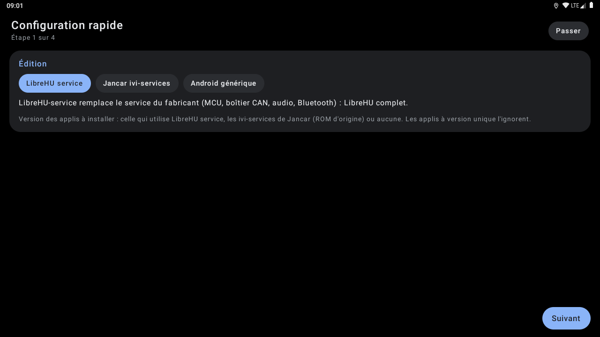<br>Configuration | 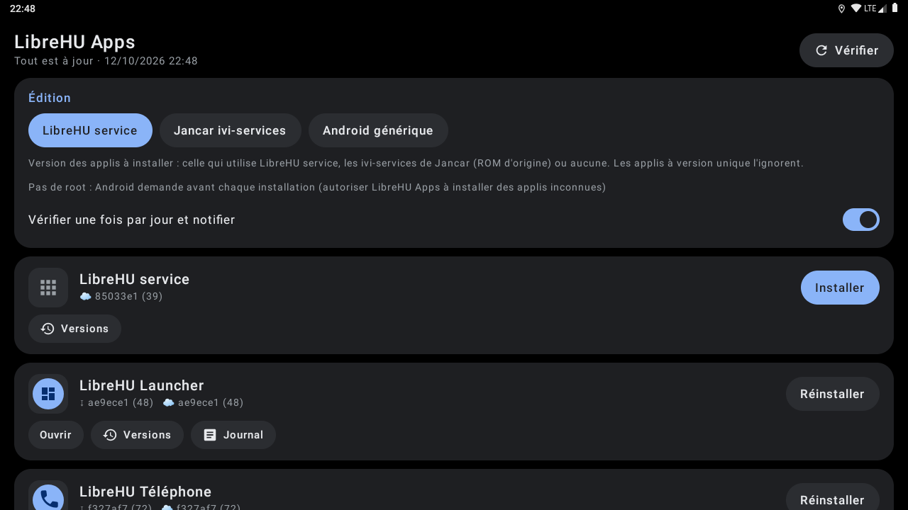<br>Applis |
| 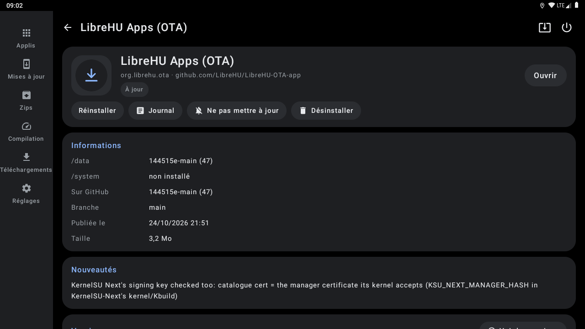<br>Fiche d'une appli | 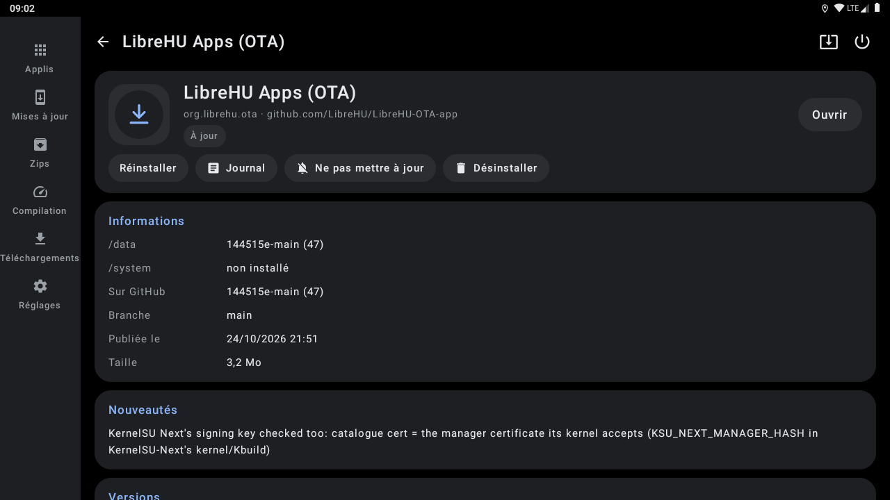<br>Versions |
| 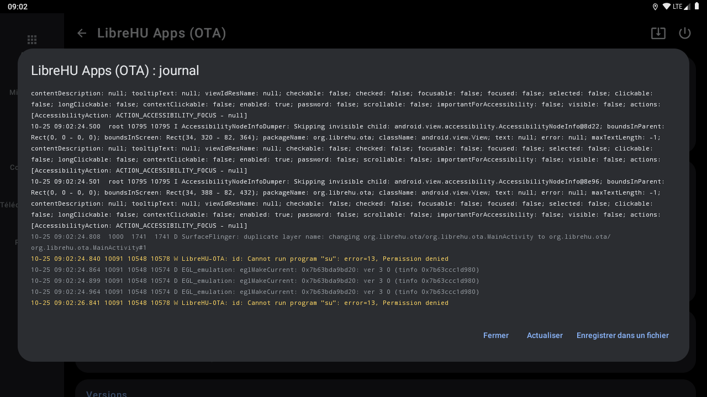<br>Changements | 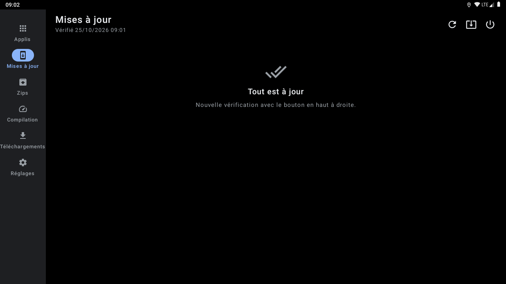<br>Mises à jour |
| 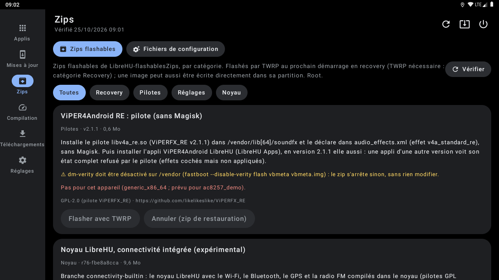<br>Zips | 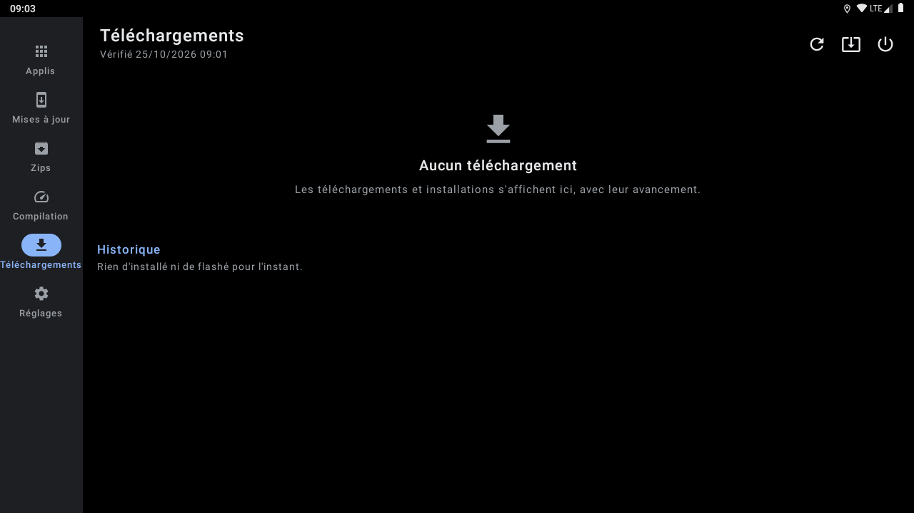<br>Téléchargements |
| 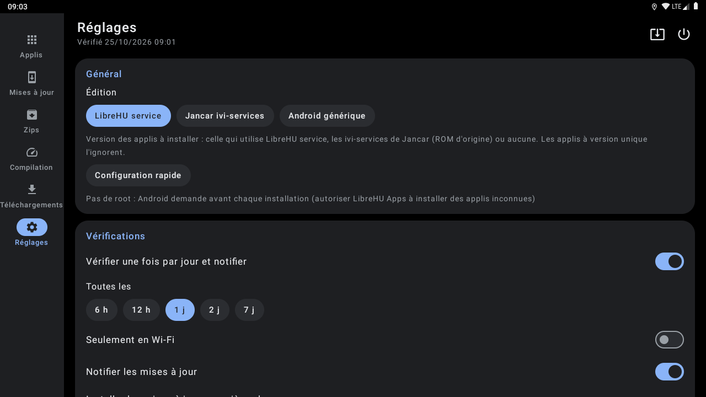<br>Réglages | 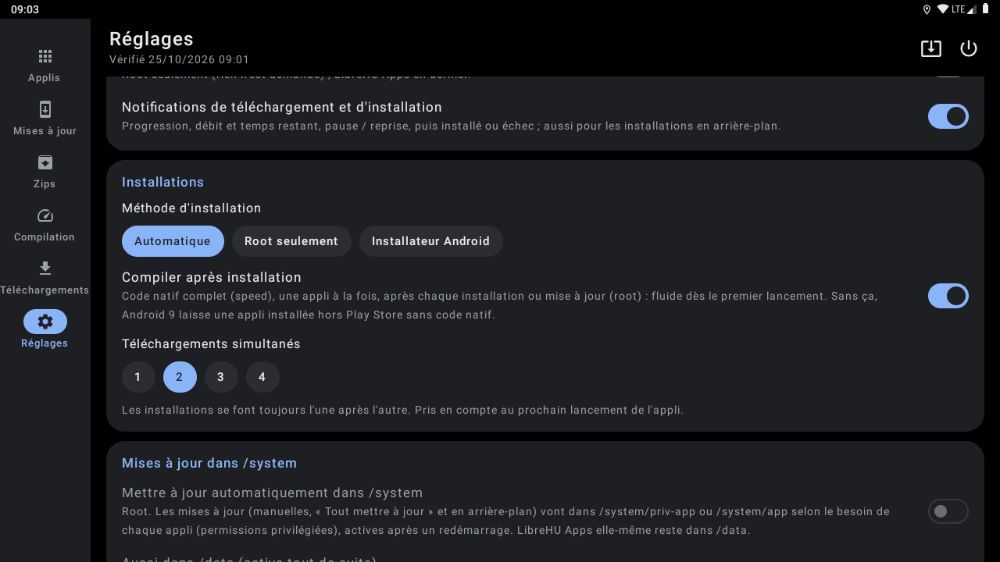<br>Réglages (2) |
| 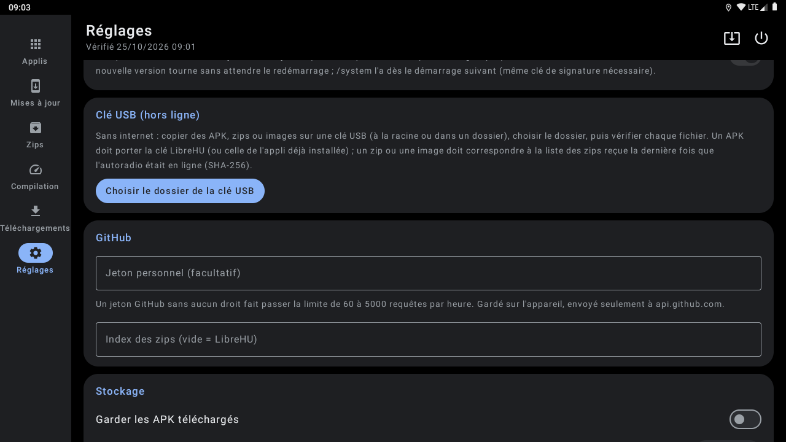<br>Réglages (3) | 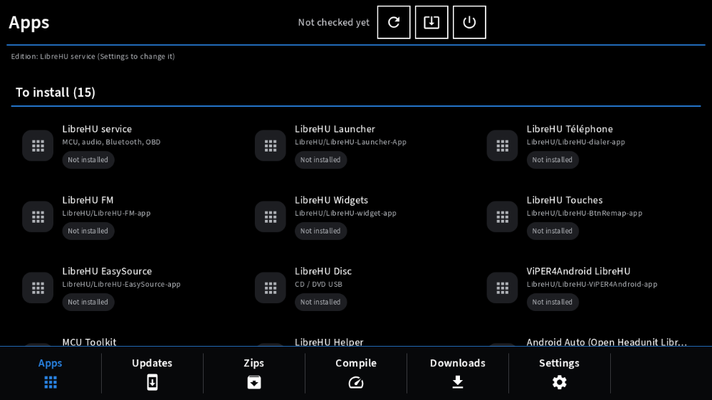<br>Style Modularer Infotainment-Baukasten |
| 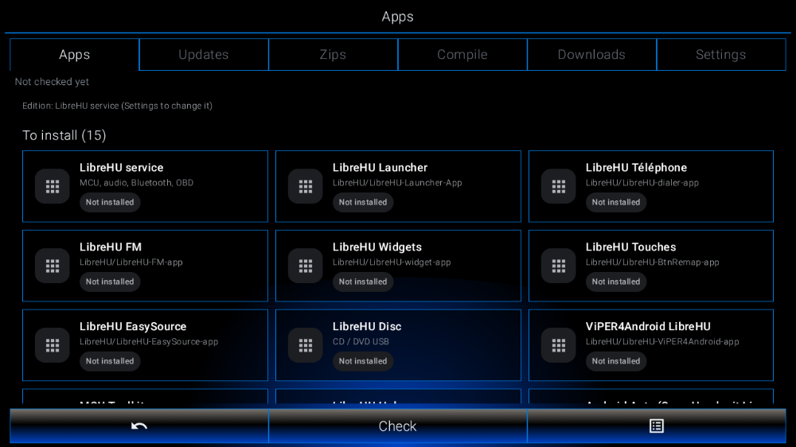<br>Style LHU-Link |   |

Captures sur l'émulateur Android 9 (1280×720, 160 dpi comme l'autoradio), sans autoradio branché : les valeurs du véhicule et de la MCU sont vides. Refaites-les avec l'action **Screenshots** de [LibreHU-OTA-app](https://github.com/LibreHU/LibreHU-OTA-app/tree/main/screenshots). Galerie : [librehu.github.io/screenshots/ota.html](https://librehu.github.io/screenshots/ota.html).

## Captures automatiques

L'action **Screenshots** ([screenshots/](screenshots/)) installe la dernière release de chaque appli sur un émulateur
Android 9 (1280×720, 160 dpi, en français ; Android 11 pour LibreHU service, FM et MCU Toolkit, dont le code natif
est ARM seulement), suit `screenshots/plan.json` (ouvrir, toucher un texte, capturer) et publie les PNG dans la
release `screenshots`. Ce sont les images des galeries des README.

## Vérifier que toutes les mises à jour sont visibles

`python3 tools/check_releases.py` : pour chaque appli de `catalog.json` et chaque branche publiée, vérifie que
`latest-<branche>` a une `release.txt` lisible avec un `versionCode` et qu'elle a été construite depuis le dernier
commit de la branche (sinon la CI a échoué ou tourne encore : LibreHU Apps montre l'ancienne version). Pour les applis à
éditions (`librehu-service`, `ivi`, `main`), signale aussi une branche d'édition à laquelle manquent des commits de
`main` : un correctif poussé seulement sur `main` n'arrive dans cette édition qu'une fois `main` fusionnée dedans. La
mise à jour est proposée quand le `versionCode` publié dépasse celui installé (nombre de commits de la branche).

## Appli téléphone (LibreHU Bridge)

Réglable depuis le téléphone par l'appli LibreHU Bridge (Android et iPhone), à travers LibreHU-service : les applis (versions, vérifier, installer, mettre à jour) et tous les réglages (édition, vérifications, installations, /system).
Fournisseur `<paquet>.bridge` (`bridge/BridgeProvider.kt`), réservé aux applis signées avec la clé LibreHU (permission
`org.librehu.permission.BRIDGE`, vérifiée dans `call()` lui-même) ; format décrit dans
[LibreHU-service, docs/bridge.md](https://github.com/LibreHU/LibreHU-service/blob/main/docs/bridge.md).

## Construire

Action **Build** (artefact et release `latest-main`), ou `./gradlew :app:assembleDebug` avec le SDK Android.

## Optimisation (R8)

L'APK publié par la CI (`assembleRelease`) est **optimisé par R8** : code et ressources réduits et optimisés, ce qui
rend Jetpack Compose nettement plus fluide ([Compose performance](https://developer.android.com/develop/ui/compose/performance)),
**sans renommage** (`-dontobfuscate` dans `app/proguard-rules.pro`) : les traces des journaux restent lisibles. Les
règles gardent aussi ce qui n'est appelé que par son nom (méthodes natives, helpers root lancés par `app_process`). Si
une fonction plante avec « class / method not found », regarder `usage.txt` dans l'artefact *R8 reports* de la CI (ce
que R8 a retiré) et ajouter une règle `-keep`.

**Contrôles des sources distantes** : les noms de paquets et de dépôts du catalogue, ainsi que les identifiants des
zips et des configs, servent à nommer des fichiers et entrent dans des commandes root. Une entrée hors format
(paquet `a.b.c`, dépôt `propriétaire/nom`, identifiant en lettres, chiffres, `.`, `_` ou `-`) est ignorée. Sur
Android 11 et plus, `QUERY_ALL_PACKAGES` sert à voir toutes les applis du catalogue, même celles qu'il ajoute plus
tard.

**Styles Modularer Infotainment-Baukasten et LHU-Link de LibreHU Launcher** : c'est le launcher qui les choisit et les demande à l'appli (il publie `style` = `factory` ou `ambient`, comme pour le style rétro) ; l'appli suit tout de suite : palette noire du style même en mode jour, coins carrés partout, police Source Sans 3 pour Modularer Infotainment-Baukasten (SIL OFL 1.1, `third_party/SourceSans3-LICENSE.md`), lettres fines pour LHU-Link. Rien à régler dans l'appli.

Les **fenêtres** (confirmations, choix, listes) suivent aussi le style : boîte noire à filet blanc (Modularer Infotainment-Baukasten) ou bleu nuit à filet d'accent (LHU-Link). Le menu Redémarrer / Recovery du style d'usine est une fenêtre à deux touches.

**Son des touches** : chaque toucher (sans glisser ni appui long) fait le petit son choisi dans LibreHU Launcher
(Paramètres → Personnalisation → Son des touches : un son par style parmi 26, ou aucun) ; le launcher le publie
(colonne / extra `click`), un launcher plus ancien donne le son par défaut de son style. Sons de LibreHU (synthétisés),
de **Kenney** ([kenney.nl](https://kenney.nl/assets/interface-sounds), CC0, version WAV de **Hugo Locurcio (Calinou)** :
[Calinou/kenney-interface-sounds](https://github.com/Calinou/kenney-interface-sounds)) et de l'**Android Open Source
Project** (sons tactiles, Apache 2.0) : détail et licences dans `third_party/KEYCLICK-SOUNDS.md`
(`res/raw/click_*.wav`, `ui/KeyClick.kt`).

L'appli prend aussi la **mise en page** de ces styles (`ui/OtaStyled.kt`, éléments communs dans `ui/CarKit.kt`) :
**Modularer Infotainment-Baukasten** = titre sur un trait de la couleur d'accent avec l'état de la dernière
vérification et des touches encadrées (vérifier, tout dans /system, redémarrer), les pages (Applis, Mises à jour,
Zips, Compilation, Téléchargements, Réglages) en touches du bas ; **LHU-Link** = pages en onglets encadrés, barre du bas
Retour / Vérifier / Options (tout dans /system, redémarrer, redémarrer en TWRP). Cartes, interrupteurs, touches et
titres de section prennent le dessin du style. Aucun logo, nom, icône, police ni image d'un constructeur.

**Style rétro et police de LibreHU Launcher** : quand le launcher est en style rétro (les couleurs d'un afficheur
d'autoradio tirées de sa couleur d'accent, couleur RGB comprise), cette appli prend sa palette (jour ou nuit) ; quand
la **police d'afficheur à segments** y est choisie (dans tous les styles), cette appli la prend aussi, en majuscules
sans accents (« LibreHU Seg14 », tirée de DSEG14 © keshikan, SIL Open Font License 1.1, voir
`third_party/DSEG-LICENSE.txt`). Le launcher publie le style, la police et la palette par
`content://org.librehu.launcher.theme/theme` (colonnes `style`, `font`, `background`, `surface`, `surface_high`,
`on_accent`, `text`, `text_dim`) et par la diffusion `org.librehu.action.THEME_CHANGED` (mêmes noms en extras).

## Soutenir le projet

LibreHU est développé bénévolement, sur le temps libre, et toutes ses applis restent gratuites. Si le projet vous est
utile, vous pouvez le soutenir par un don sur [Liberapay](https://liberapay.com/DokT/donate) (association française à
but non lucratif, dons récurrents) :

[](https://liberapay.com/DokT/donate)
[](https://liberapay.com/DokT/)
